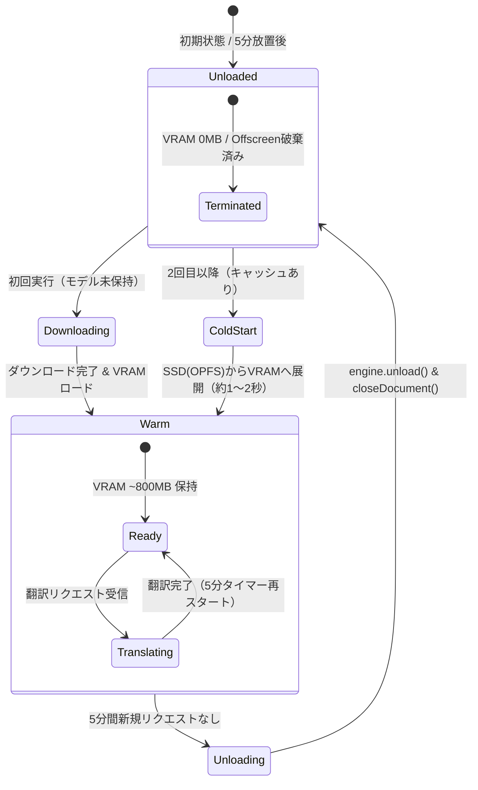

# ハイブリッド型 WebGPU × ローカルLLM 翻訳アーキテクチャ設計書

## 1. 概要と基本コンセプト

### 1.1 ハイブリッド設計の狙い
本拡張機能は、**「導入の手軽さ（Zero-Setup）」**と**「ヘビーユース時の性能・拡張性」**を両立する**ハイブリッド構成**を採用する。

- **通常利用（デフォルト）: Built-in WebGPU モード**
  - 外部サーバー不要。ブラウザ拡張単体で完結。
  - 一昨日（2026/11/05）公開された **「PLaMo 3 Translate 0.8B」**（約500MB）を内蔵推論。
  - **動的オフロード（5分タイマー）**により、非翻訳時はVRAM消費を0MBに抑える。
- **拡張利用（フォールバック）: External Server モード**
  - これまで通り **llama.cpp（Vulkan/CUDA）、Ollama、LMStudio** などの外部ローカルサーバーと接続。
  - PLaMo 3 の大型モデル（2B, 8B, 31B）や、TranslateGemma / Hunyuan などの他モデルをネイティブ速度で動かしたい場合に設定画面から即座に切り替え可能。
  - 既存の資産（用語集、キャッシュ、自動翻訳、バッチ最適化など）は**一切削ぎ落とさず100%継承**する。

---

## 2. プロバイダー構成と動作比較

設定画面のプロバイダー選択に `builtin-webgpu` を追加し、デフォルトに設定する。

| 項目 | ① Built-in WebGPU (デフォルト) | ② External Server (既存・拡張) |
| :--- | :--- | :--- |
| **対象ユーザー** | 手軽に使いたい時、出先・ノートPC | 最高速・最高品質（8B以上）で動かしたい時 |
| **前提条件** | なし（ブラウザのみで完結） | Ollama / LMStudio / llama-server の起動 |
| **採用モデル** | `pfnet/plamo-3-translate-0.8b-GGUF` (Q4_K_M) | 任意（PLaMo 3 0.8B/2B/8B/31B, Qwen等） |
| **推論エンジン** | `hachiue` 0.3.1 (WebGPU) ※当初 wllama を予定していたが、同梱 llama.cpp が `plamo3` tokenizer 未対応のため変更（詳細は§7.2.1） | ネイティブGPU (Vulkan / CUDA / Metal) |
| **ダウンロード** | 初回のみブラウザが自動取得（約500MB） | ユーザーがCLIやアプリで事前ダウンロード |
| **VRAM管理** | **動的オフロード（5分無操作で 0 MB 解放）** | 外部サーバー側のプロセス管理に依存 |
| **フォールバック** | WebGPU非対応環境時は自動でExternalを案内 | サーバー停止時は接続エラーを表示 |

---

## 3. システムアーキテクチャ

### 3.1 コンポーネント構成図

```mermaid
flowchart TB
    subgraph Browser Tab
        Content[Content Script\nページテキスト抽出 / DOM置換]
    end

    subgraph Chrome Extension MV3
        Popup[Popup / Options UI\n翻訳実行 / プロバイダ切替]
        SW[Background Service Worker\nメッセージルーター & 共通機能\n・用語集 Glossary\n・翻訳キャッシュ Cache\n・自動翻訳判定]
        
        subgraph Mode A: Built-in [Provider: builtin-webgpu (Default)]
            Offscreen[Offscreen Document\nWebGPU Context]
            Engine[hachiue Engine\nPLaMo 3 0.8B (plamo3 arch)]
            Timer[5分アイドルタイマー]
            OPFS[(OPFS\nhachiue チャンクキャッシュ\nplamo-3-translate-0.8b-Q4_K_M.gguf ~546MB)]
        end
    end

    subgraph Mode B: External [Provider: ollama / lmstudio / custom]
        ExtServer[(外部ローカルサーバー\nlocalhost:11434 / 8080\nPLaMo 8B, Vulkan, etc.)]
    end

    Content <-->|chrome.tabs.sendMessage| SW
    Popup <-->|chrome.runtime.sendMessage| SW

    %% プロバイダ分岐
    SW -->|provider == 'builtin-webgpu'| Offscreen
    Offscreen <--> Engine
    Engine <--> OPFS
    
    SW -->|provider == 'ollama' / 'lmstudio'| ExtServer
```

### 3.2 既存資産の完全共有
Background Service Worker が持つ以下の共通パイプラインは、**どちらのプロバイダを選択しても共通して動作**する：
1. **用語集（Glossary）注入**:
   - 固有名詞や独自ラベルを翻訳前に置換・プロンプト注入。
2. **翻訳キャッシュ（IndexedDB / Session）**:
   - 同一テキストの重複翻訳をスキップ（WebGPU / 外部サーバー問わず有効）。
3. **PLaMo改行バッチ処理**:
   - 複数要素を改行（`\n`）でまとめて1回のリクエストで翻訳する高速化ロジック。

---

## 4. Built-in WebGPU の動的オフロード制御

### 4.1 状態遷移図



### 4.2 クリーンアップシーケンス
1. 最後の翻訳完了時、Offscreen Document 内の 5分タイマーを開始。
2. 5分以内に新たな翻訳が来ればタイマーをリセット（ウォーム状態を維持し、連続翻訳は待ち時間ゼロ）。
3. 5分経過した場合：
   - Offscreen Document 内で `engine.dispose()` を実行し、WebGPU デバイス・GPUバッファを破棄（`dispose()` は GPU デバイスを即時 `destroy()` することをスパイクで確認済み）。
   - Service Worker から `chrome.offscreen.closeDocument()` を実行し、Offscreen Document（レンダラプロセス）ごと消去。
   - **VRAM およびメモリ消費が完全に 0 MB に復帰する**。
   - 補助として SW 側でも `chrome.alarms`（約30秒粒度）でアイドルを監視し、Offscreen 側タイマーの取りこぼしを二重にカバーする。

---

## 5. ディレクトリ構成と変更範囲

既存のUIやコードベースを汚さず、推論エンジンのみを独立して組み込む。

```
offline-browser-translate/
├── manifest.json              # permissions に "offscreen" を追加
├── background.js              # プロバイダ分岐に builtin-webgpu を追加（既存コード温存）
├── cache.js                   # 既存のまま（共有利用）
├── languages.js               # 既存のまま（共有利用）
├── content.js                 # 既存のまま
├── popup/                     # UIにモデルロード進捗表示を追加
├── options/                   # プロバイダ選択肢に「内蔵 WebGPU」を追加
├── docs/
│   └── webgpu-plamo3-architecture.md  # 本設計書
└── offscreen/                 # 【新規追加】WebGPU推論モジュール
    ├── offscreen.html
    ├── offscreen.bundle.js    # ビルド成果物（コミットして拡張単体でロード可能にする）
    ├── src/
    │   └── offscreen.js       # hachiue ラッパー & 5分オフロードタイマー
    ├── package.json           # hachiue@0.3.1 (固定), esbuild
    ├── build.mjs              # 単一バンドルするビルドスクリプト
    └── dist/                  # 作業用出力（offscreen.bundle.js はコミット対象）
```

---

## 6. 段階的実装ロードマップ

既存の動作を壊さないよう、ステップバイステップで検証しながら進める。

### Phase 1: スタンドアロン動作検証 — **完了（2026-11-08）**
- 単体HTMLで WebGPU 上のロード・翻訳・改行バッチ・OPFSキャッシュ再ロード（1.3秒）を確認。当初の wllama 案は `plamo3` トークナイザー未対応で不採用。**hachiue 0.3.1 を本線に採用**（§7.2 参照）。
- 残課題: 用語集指定・form 指定が反映されない点について、Phase 3 組み込み時に再検証する。

### Phase 2: Offscreen Document & オフロード制御の実装
- `offscreen/` ディレクトリを構築し、バンドルスクリプトを作成。
- Service Worker から Offscreen Document を動的に生成・メッセージ通信・破棄（5分タイマー）できることを確認。
- Chromeタスクマネージャで、オフロード時にVRAM/メモリが確実に解放されることを検証。

### Phase 3: Background Router への統合 — **完了（2026-11-08）**
- `translate()` に `builtin-webgpu` プロバイダーを追加（`isBuiltin` でモデルを `plamo-3-translate-0.8b-Q4_K_M` に固定、provider auto-detect スキップ、offscreen API 非対応環境は明示エラー）。
- PLaMo 改行バッチ経路（`plamoMode`）に内蔵エンジンを接続。用語集は `collectGlossaryMatches()` で一致語を `{source,target}` 化し、**PFML3 ネイティブ glossary**（index/item、小文字 form）で 0.8B に実際に効く形で注入（hachiue helper 不使用）。
- options/popup の Provider 選択に「内蔵」を追加。Firefox 等の offscreen 非対応環境では選択肢自体を非表示（SW でも明示エラーにフォールバック）。builtin 選択時はサーバー URL 行を隠す。popup の provider 変更は即時保存＆モデルリスト再取得（従来の「変更が即反映されない」既存バグも併せて修正）。
- **E2E PASS**（headless Chrome for Testing・拡張メッセージ経路）: SAVE_SETTINGS→SAVE_GLOSSARY→TRANSLATE 3項目バッチで「管理画面を開き…」（用語集適用）＋ JA→EN 単文を確認。
- 残: Phase 4（ダウンロード進捗 UI、フォールバック文言、ライセンス表記の補強、`unlimitedStorage` 検討）。

### Phase 4: UIの対応 & フォールバック — 一部完了（2026-11-09）
- 初回ダウンロードのプログレス表示を3か所に追加: **ページ側ウィジェット**（content.js の `BUILTIN_PROGRESS` 受信 → `updateProgressWidget`）、**ポップアップ**（Provider=builtin 時にモデル行+ミニプログレスバー）、**オプションの「内蔵モデル」セクション**（進捗バー/ダウンロード済み容量/状態/`Download model`/`Delete model` ボタン、ライセンス明記）。
- SW は `OFFSCREEN_PROGRESS` を保持し、builtin 翻訳を開始したタブへ `BUILTIN_PROGRESS` を転送。**オフスクリーンへのステータス問い合わせは workChain の外で即時応答**（ダウンロード中のステータスポーリングが「error」を誤表示していたバグを修正）。
- `BUILTIN_MODEL_CACHE_INFO` は SW から直接 OPFS を測定（hashUrl を移植）。オフスクリーン文書を起動しなくても容量・状態を正確に返せる。`BUILTIN_MODEL_DELETE` はエンジン dispose → OPFS の `.gguf.bin`/`.meta.json` 削除 → IndexedDB `hachiue-model-cache-v1` 削除 → オフスクリーン文書を閉じる。
- 検証: E2E PASS。フィクスチャページの翻訳でウィジェットが「Preparing built-in model… 0%→100%」を表示し実際に日本語化されること、options/delete/再DL、popup 表示を確認。`state=error` を誤表示する直列化バグを検出・修正（STATUS/CACHE_INFO を workChain 外に）。
- 残: ライセンス表記の外部公開可否の判断は未（公開予定なしの前提）、VRAM 解放の目視確認（Chrome タスクマネージャ）は未実施。


---

## 7. 実装前検証ログ（2026-11-08、feat/builtin-webgpu ブランチにて確認）

設計書を実装に移す前に、記載前提を一次ソースで検証した結果。**§2〜§6 の本文中の記述のうち、以下と矛盾するものはここを優先する。**

### 7.1 検証済み（コード・一次ソースで確認）

| 項目 | 結果 |
| :--- | :--- |
| モデルリポジトリ | `pfnet/plamo-3-translate-0.8b-GGUF` 実在（2026-11-05 公開、`lastModified: 2026-11-07`）。Q4_K_M は `plamo-3-translate-0.8b-Q4_K_M.gguf`、約 546 MiB |
| コミットピン留め | 現行 main の SHA は `0c4af2b003fdd94b6868aa955414c1c86ee96997`（2026-11-07）。ダウンロードURLはこの SHA にピン留めすること（OPFSキャッシュキーの安定化・供給側更新の影響遮断のため） |
| ライセンス | **PLaMo Community License**（`license:other`）。個人・非商用は無料、商用は PFN の許諾が必要。拡張本体は MIT。**オプション画面とREADMEへのライセンス表記が必要** |
| chat template | GGUF の `tokenizer.chat_template` に Jinja テンプレートが**埋め込み済み**（llama.cpp 用、`chat_template.jinja` も同梱）。`chat_template_kwargs: { target_lang }` で `createChatCompletion` から翻訳可能。ハンドライト PFML3（`createCompletion`）も pass-through としてサポートされる |
| wllama 3.8.1 | WebGPU は V3.1〜 **自動有効**（`n_gpu_layers` デフォルト 99999 = 全レイヤーGPU）。`n_ctx` のデフォルトは **1024 → 明示的に設定必須**（2048 推奨）。`jinja: true` をロード時に渡すこと |
| OPFS キャッシュ | `loadModelFromUrl(url, { useCache: true /* default */ })` で**自動的に OPFS へ保存・復元**（`CacheManager` → `COSBackend` → `OPFSBackend`）。設計書の「OPFS ~500MB」前提は正しい |
| 途中中断 | wllama は Range 再開非対応（Whole-stream 書き込み）。中断したダウンロードは最初からやり直しになる。546MB なので許容。UI 上は「最初からやり直す」旨を表示すること |
| `wllama.exit()` | 存在する（`async exit(): Promise<void>`）。オフロード実装はこれで OK |
| `chrome.offscreen` | `Reason.WORKERS`（"spawn workers"）を使用。Chrome/Edge 109+。オフスクリーン文書から使える拡張 API は `chrome.runtime` のみ（SW がストレージを持つ既存設計と整合）。文書は静的HTML必須・1 拡張につき同時 1 つ |
| Firefox | **Offscreen API 非対応**（webextensions#170 未解決）。`chrome.offscreen` 不在環境では `builtin-webgpu` を選択肢から除外し、外部サーバーモードのみとする。manifest の gecko 設定は維持 |
| マルチスレッドWASM | COOP/COEP (`crossOriginIsolated`) が必要。拡張ページでは事実上使えないため、**WebGPU 失敗時は単スレッド WASM にフォールバック、それも駄目なら外部サーバーへ誘導** |
| コンテキスト | PLaMo の入出力合計上限は 32,768 トークン（学習時）。翻訳品質の観点でも長文は分割前提。ページ側の要素単位翻訳なので 2048 で実用十分 |

### 7.2 Phase 1 スパイクの結果（2026-11-08 実機・headless Chrome / AMD RDNA-1 で検証）

#### 7.2.1 wllama 3.8.1 経路 — **不採用**

| 項目 | 結果 |
| :--- | :--- |
| WebGPU アダプター | ✅ 検出成功（AMD RDNA-1、`ggml_webgpu` で "using device WebGPU"） |
| ダウンロード 546MB | ✅ 約 32 秒（~17 MB/s）、% 表示も動作 |
| OPFS キャッシュ | ✅ 有効。2回目のロードは **0.5〜0.9 秒**（再ダウンロードなし） |
| モデルのロード | ❌ **llama.cpp が `unknown tokenizer: 'plamo3'` で失敗**。wllama 3.8.1 同梱の llama.cpp が PLaMo 3 のトークナイザー/アーキテクチャを未サポート。`loadModelFromUrl` はエラーを投げずに解決し、UI 側が失敗を検知しにくい（`isModelLoaded()` で確認必須） |
| 推論 | ❌ `chat.cpp: GGML_ASSERT(chat_templates != nullptr)` で WASM abort → 以降の全リクエストが `wllama has crashed` |
| `exit()` | ✅ 即時に返る（ただし上記の通り破損後の状態でも即座に完了する） |

**判断**: upstream llama.cpp は PLaMo 3 をサポート済み（`ggml-org/llama.cpp@c77dd68`、`b11318` の `PLaMo-3 (#29734)`、`#30045` 系の tokenizer 修正など。2026-10 上旬にマージ）。wllama は同梱 wasm を追随ビルドするまで使えない。ソースから wllama をビルドする選択肢（Docker 必要、`git submodule update --remote --merge`）はあるが、ビルドの脆弱性・メンテナンスコストが大きく、まず hachiue を検証することにした。

#### 7.2.2 hachiue 0.3.1 経路 — **採用**（2026-11-08 実機検証）

| 項目 | 結果 |
| :--- | :--- |
| パッケージ | Apache-2.0、依存ゼロ、`npm i hachiue`。API: `HachiueEngine.create({ url, backend: 'auto'\|'webgpu', onProgress })` → `translateText()` / `generate()` → `engine.dispose()`。`isModelCached` / `getCachedModelSize` / `clearModelCache` / `prefetchModel` もあり |
| WebGPU ロード | ✅ `backend=webgpu` (adapter=high-performance) で成功。初回ダウンロード ~61秒（~10MB/s）、フェーズ表示（header→weights→ready）あり |
| アーキ識別 | ✅ `plamo3`、16 layers、vocab 107520、plamo3 トークナイザ（Unigram DP）を認識 |
| EN→JA | ✅ 「会議は来週の月曜日に日程が変更になりました。」0.54秒（prefill 88.7 tok/s、decode 38.7 tok/s） |
| JA→EN | ✅ 「Please open the project management screen.」0.29秒 |
| 改行3行バッチ | ✅ **出力3行・順序アライメントOK**（0.84秒） |
| JA長文→EN | ✅ 自然な英訳（1.9秒、57→55 tok） |
| 2回目ロード | ✅ **1.3〜1.4秒**（OPFSチャンクキャッシュ）。`dispose()` も即時返り GPUDevice が破棄されることを確認 |
| 用語集 | ❌→✅ **切り分け完了（2026-11-08）**: hachiue ヘルパー（`translateText`）が生成する PFML3 が公式フォーマットとずれていたことが原因と判明（glossary が `<|plamo:msg|>src\ttarget`、form が `<|plamo:val|>Polite`（大文字）。**モデルは無視する**）。**公式 PFML3 を手組み**（`<|plamo:index|>src<|plamo:item|>tgt` の繰り返し、小文字 `polite`/`plain`）で `engine.generate()` を直接呼ぶように拡張を改修したところ、glossary・form ともに正常動作を確認。拡張は translateText を経由しない設計に確定 |
| form 指定 | ❌→✅ 上記と同一原因・同一解決。helper 経由は polite/plain を区別できなかったが、手組み PFML3（小文字値）なら `form=polite → 「このシステムは便利です。」／ form=plain → 「このシステムは便利だ。」` を正しく区別。E2E（拡張経由）で glossary 適用を確認済み |
| キャッシュAPI | `isModelCached()` / `getCachedModelSize()` が `false` / `0.0 MB` を返すが、実際は OPFS からのロードが 1.3 秒で行われており、**エンジンの内部キャッシュは機能している**（レポート側の判定キーが異なる模様。実装では実測ベースで信頼する） |
| 注意点 | 初回ロードは約60秒かかるので、UI で進捗を見せないと「固まった」と思われる。546MB を毎回落とさせないよう、オプションで「モデルの事前ダウンロード」ボタンを用意するのが親切 |

**判断**: hachiue 0.3.1 を本線とする。リスク（0スター個人プロジェクト）に対しては以下で対処する:
1. `offscreen/` 内に `hachiue@0.3.1` を**バンドルしてコミット**（npm で落ちても拡張ビルドが壊れない）
2. バージョンは厳密に固定（`0.3.1`）。メジャーアップは各フェーズで評価してから
3. Apache-2.0 ライセンス表記（hachiue の LICENSE を offscreen 同梱物に含める）
4. wllama 自己ビルド（`git submodule update --remote --merge` + Docker）を**保険の選択肢**として文書に残す（§7.2.1）


#### 7.2.3 検証から判明した実装上の注意（エンジンに関わらず）

1. `loadModel` の Promise 解決をもって成功とみなしてはいけない。**必ず `isModelLoaded()` / 実際の生成が返ることで成功判定**し、失敗時は offscreen から SW へ `BUILTIN_MODEL_ERROR` を通知する
2. AMD RDNA-1 クラスの GPU でも WebGPU アダプターは取得できた。ただし VRAM 表示は "2048 MiB free" と出る（ggml の制限値の模様）。`maxSeqLen` は 2048 程度に抑えるのが無難
3. headless Chrome では `crossOriginIsolated=false`、`navigator.gpu` は動作。`requestAdapter` の `powerPreference` は Windows では無視される（警告が出るが無害）
4. モデルは PLaMo Community License（商用は PFN 許諾が必要）。拡張に同梱は**しない**、HF から都度 DL させることを維持する


### 7.3 この検証から生じる既知の修正点（実装時に反映）

1. **huggingface.co の host permission は不要と判明**（2026-11-08 実測）: `resolve/<sha>/<file>` はまず huggingface.co が 302 を返し、`Origin` ヘッダに対して `Access-Control-Allow-Origin: <origin>` をエコーする。リダイレクト先の CDN（us.aws.cdn.hf.co）は `access-control-allow-origin: *` を返す。つまり**通常の fetch がそのまま通る**。拡張が huggingface.co への追加権限を要求する必要はない（インストール時警告も不要）。`manifest.json` の optional_host_permissions は `<all_urls>` のまま維持
2. §4 のタイマー: Offscreen 側の 5 分タイマーに加え、**SW 側でも `chrome.alarms`（約30秒粒度）で `closeDocument()` を二重化**すること。SW はいつ終了されてもよい設計にする
3. §5 の `options/`: ライセンス表記（PLaMo Community License の商用制限）を追加
4. §6 Phase 1: 上記 7.1 を「検証済み」として読み、実機では 7.2 のリスクだけを叩く
5. §3.1 の mermaid 図: OPFS は `plamo-3-translate-0.8b-Q4_K_M.gguf`（約546MB）に修正

---

### 7.4 Firefox 向け manifest の分割 (2026-11-09)

- Firefox (about:debugging / AMO) は manifest が未知の offscreen パーミッションを宣言すると読み込み/提出を拒否する。実デバイス調査: MDN の permissions 一覧と API リファレンスに offscreen は存在しない（404）。
- そこで manifest.firefox.json（=manifest.json から "offscreen" のみ除去したもの）をリポジトリに同梱し、README に Firefox への読み込み手順（Copy-Item manifest.firefox.json manifest.json）と AMO 提出時はこのファイルを manifest.json として zip する旨を記載した。
- alarms は Firefox でも利用できるため残す。background.scripts が Firefox 側の入口で、service_worker キーは無視される（既存の構成を維持）。
- Chrome / Edge 向けは引き続き manifest.json をそのまま使い、clone & load unpacked でビルド不要（bundle 同梱済み）。

### 7.5 実機ベンチマーク: WebGPU vs llama.cpp (2026-11-09, AMD Radeon RX 5700 / RDNA-1)

同一マシン・同一 GGUF（plamo-3-translate-0.8b-Q4_K_M, 573,125,952B）での実測。llama.cpp は b12121（Vulkan ビルド）の llama-bench、WebGPU 側は本拡張の本番経路（BUILTIN_SELFTEST: hachiue + PFML3 prompt）で計測。

| 環境 | pp512 (prefill) | tg128 (decode) | 備考 |
|---|---|---|---|
| llama.cpp Vulkan (`-ngl -1`) | 3,438.68 ± 32.62 tok/s | 348.58 ± 6.63 tok/s | 同一GPUでの上限 |
| llama.cpp CPU のみ (`-ngl 0`, 8 threads, Haswell) | 2,166.16 ± 82.26 tok/s | 33.44 ± 1.50 tok/s | RDNA-1 でもCPUが十分速い |
| WebGPU (Chrome + hachiue, 本拡張経路) | 約32–44 tok/s（短文） | **40.4 tok/s 平均**（39.0–42.0） | SELFTEST ×5 回 |

所感:

- decode は WebGPU 40.4 vs llama.cpp Vulkan 348.6 → **約8.6倍 llama.cpp が速い**。ただし WebGPU も CPU-only llama.cpp（33.4）より速い。
- 単文の wall-clock は約0.28秒/本。ページ一括のような数文なら実用範囲。長文・文書の一括翻訳では差が体感できる。
- RDNA-1（RX 5700）は INT dot / 行列コアなしにも関わらず WebGPU で 40 tok/s 出ており、hachiue の効率は良好。
- プレフィルは計測条件が違う（pp512 vs 短文 ~30 tok）ので単純比較は不可。decode tok/s が比較可能な指標。
